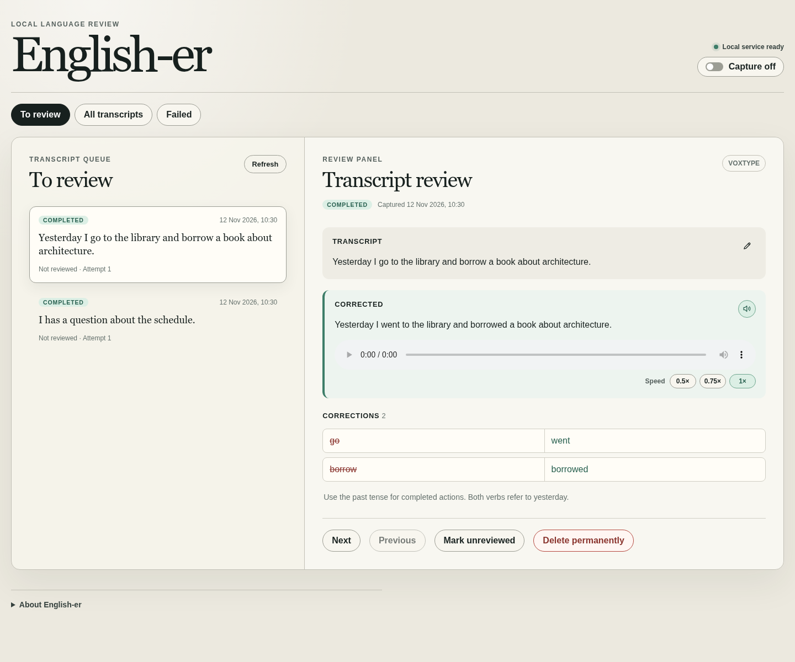

# English-er

Practice English with your own dictated text on Linux: capture Voxtype transcripts, review and edit AI corrections, and listen to the corrected text in a local web interface.



*Review corrections and listen to your own dictated English.*

Capture defaults off. Corrections send transcript text through your authenticated Codex CLI to its AI provider. Kokoro-82M generates speech locally on a CUDA GPU. Transcripts and generated audio stay on disk until explicitly deleted; provider-side retention is separate.

## Install from source

The complete workflow requires Linux with systemd user services, Git, [mise](https://mise.jdx.dev/), Voxtype, an authenticated Codex CLI, and a GPU supported by the pinned PyTorch CUDA runtime. The command interface targets Codex CLI 0.167.2 and Voxtype 1.1.1; other versions are unverified. CPU-only contributor checks are supported, but speech has no CPU fallback. Real desktop/provider/GPU behavior is excluded from the offline gate.

```bash
git clone https://github.com/Muatasim-Aswad/english-er.git
cd english-er
```

Follow [Development](docs/DEVELOPMENT.md#setup) for frozen dependency setup, then [Operations](docs/OPERATIONS.md#local-installation) to prepare speech, build the UI, install services, and configure opt-in capture. Open `http://127.0.0.1:8001` after installation.

## Supported workflow

- Capture completed Voxtype transcripts without changing their output.
- Review original text, corrections, and explanations; edit and recorrect independent revisions.
- Retry failed corrections, mark reviewed, and delete transcripts and associated audio.
- Play corrected text using the local Kokoro `af_heart` voice.

English-er is single-user and loopback-only. Remote access and authentication are unsupported. The Voxtype and Codex integrations are unofficial and can break when upstream behavior changes; use them under the relevant upstream terms and your account's permissions. AI suggestions require your review.

## Project guides

- [Development](docs/DEVELOPMENT.md): contributor setup and the single `scripts/verify-task check` gate.
- [Operations](docs/OPERATIONS.md): permissions, network access, installation, backup, retention, and removal.
- [Architecture](docs/ARCHITECTURE.md): ownership, runtime flow, and supported limits.
- [Contributing](CONTRIBUTING.md), [Security](SECURITY.md), and [Changelog](CHANGELOG.md).
- [Source-only releases](docs/RELEASING.md): versioned Git tags, release notes, and build identity.

Licensed under [MIT](LICENSE).
